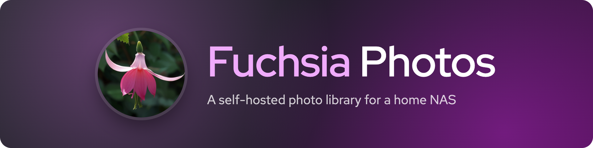
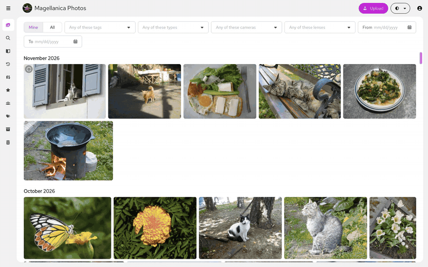
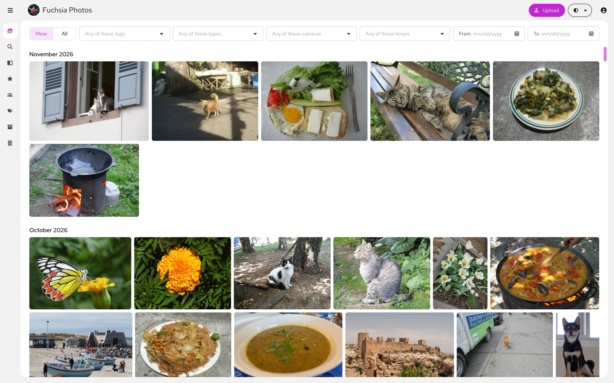
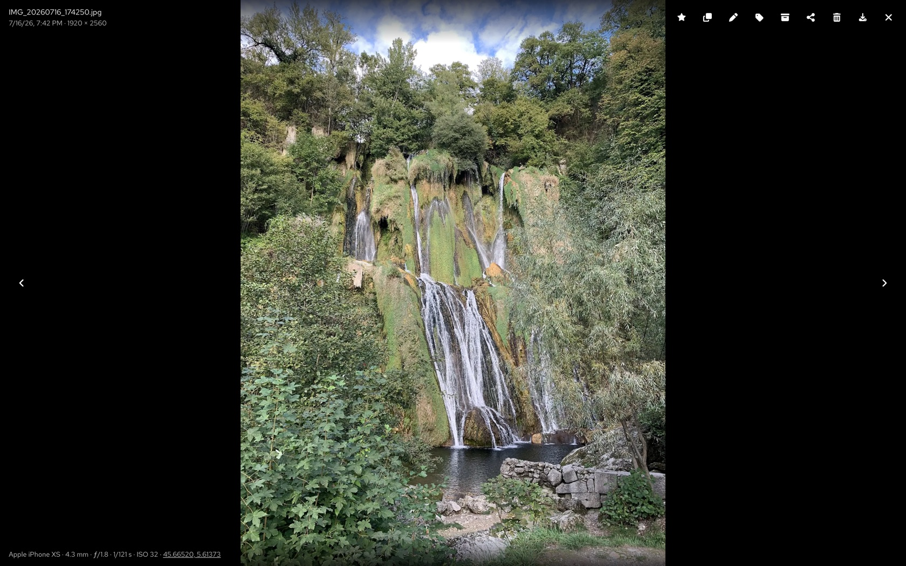
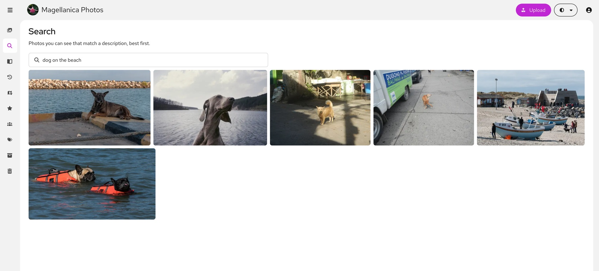
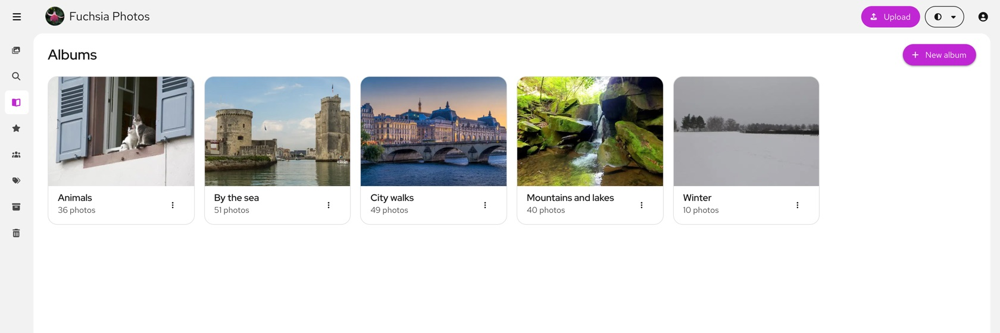

<p align="center"></p>

A self-hosted photo library for a home NAS. Photos come in from the browser, from phones over WebDAV or from a folder on the NAS, and are organized into albums and tags and shared between the people who use the server.

It is built for modest hardware. It is developed and measured on an Intel N150 with 4 cores and 16 GB of memory, and runs as one Go binary next to PostgreSQL, with no Redis or other services. Search by description is optional and can run on another machine.

**Status:** in active development. See [releases](https://github.com/denuser/fuchsia-photos/releases) and the [roadmap](docs/roadmap.md).



<table>
  <tr>
    <td width="50%"><picture><source media="(prefers-color-scheme: dark)" srcset="docs/images/screenshots/timeline-dark.jpg"></picture></td>
    <td width="50%"></td>
  </tr>
  <tr>
    <td>The timeline, by month, with filters</td>
    <td>The viewer, with the camera and the place</td>
  </tr>
  <tr>
    <td><picture><source media="(prefers-color-scheme: dark)" srcset="docs/images/screenshots/search-dark.jpg"></picture></td>
    <td><picture><source media="(prefers-color-scheme: dark)" srcset="docs/images/screenshots/albums-dark.jpg"></picture></td>
  </tr>
  <tr>
    <td>Search by description</td>
    <td>Albums</td>
  </tr>
</table>

<sub>Photos in the screenshots: Wikimedia Commons, public domain and CC0. Their dates were moved to look like a family library.</sub>

## Features

- Upload from the browser, files or whole folders, straight into an album, with previews made in the background and progress shown as it goes
- Upload from phones over WebDAV, with sync apps such as PhotoSync and FolderSync. A folder can be linked to an album
- Import from a folder on the NAS, which stays untouched. A repeated import skips the photos already imported or deleted
- Import from Google Takeout, straight from its `.zip` or `.tgz` parts: dates and places from Google, albums, descriptions, favorites, the archive and the trash, with edited copies shown over their originals
- A timeline that stays fast in large libraries, with a year scrubber and filters by date, tag, camera and lens
- Albums, personal tags, favorites, an archive, descriptions, bulk actions and a trash
- Sharing of photos and albums with all users or with specific ones, read-only for the recipient
- Users created by the administrator, with no self-registration, and two roles: administrator and user
- Search by description and similar photos, with an optional ML service
- Nightly database dumps with a tested restore, request logs and the job queue on the administration page
- The interface in ten languages: English, Russian, Simplified Chinese, Spanish, Brazilian Portuguese, German, French, Japanese, Korean and Italian; light, dark and high contrast themes

Supported formats: JPEG, PNG, WebP and HEIC photos, MP4 and MOV videos, and the motion of Google and Samsung motion photos and iPhone Live Photos. A Live Photo needs both of its files, which the browser's file picker does not hand over: see [Live Photos](docs/deployment.md#live-photos). Camera RAW formats include NEF, NRW, CR2, CR3, ARW, DNG (including Apple ProRAW), RAF, ORF, RW2, PEF and SRW. Matched RAW + JPEG pairs appear as one item. See [RAW photos](docs/deployment.md#raw-photos).

## Requirements

- Docker with Compose 2.23 or later
- A `linux/amd64` or `linux/arm64` machine. The `arm64` image has not been tried on an ARM NAS yet
- An SSD for the database and the previews is recommended. Originals can stay on a hard disk

## Quick start

This runs release `0.1.0` with PostgreSQL, the nightly backup and Caddy for HTTPS. Run the commands on the NAS:

```sh
mkdir fuchsia-photos && cd fuchsia-photos
curl -fsSL -o docker-compose.yml \
  https://raw.githubusercontent.com/denuser/fuchsia-photos/v0.1.0/deploy/compose.image.yaml
cat > .env <<'ENV'
POSTGRES_PASSWORD=change-me
SITE_ADDRESS=192.168.0.10
IMAGE_TAG=0.1.0
ENV
mkdir -p data/library data/cache data/import
sudo chown 1000:1000 data/library data/cache
docker compose up -d
docker compose exec app fuchsia-photos create-admin admin
```

Set a long password with URL-safe characters only, and the address of the NAS. The last command waits for the administrator's password. Then open `https://<address>:10304/`; to use another port, set `HTTPS_PORT` in `.env`. The certificate comes from Caddy's local CA, so the browser warns about it until that CA is trusted.

The [deployment guide](docs/deployment.md) covers the settings, TrueNAS, WebDAV, folder imports, backups and updates.

## Performance

Measured on the NAS with JPEG photos, WebP previews on the SSD and 3 workers, at 3.0 photos/s. See the [benchmark results](docs/benchmark.md#results).

| Photos | Time |
|---|---|
| 1,000 | about 5.5 min |
| 10,000 | about 56 min |

The real pipeline is somewhat slower, because these numbers leave out EXIF extraction and database writes. HEIC has not been measured, and takes longer to decode.

For tens of thousands of photos, prefer copying them to the NAS and running a folder scan over uploading through the browser.

## Documentation

- [Architecture](docs/architecture.md): decisions, processing, data model, access control and machine learning
- [Roadmap](docs/roadmap.md): stages and acceptance criteria
- [Deployment](docs/deployment.md): installing and operating on the NAS
- [Development](docs/development.md): running locally, backend, migrations, frontend and test commands
- [Benchmark](docs/benchmark.md): measuring performance on the NAS
- [Improvements](docs/improvements.md): the current list of improvements
- [Changelog](CHANGELOG.md): changes in each release

## License

[MIT](LICENSE)
